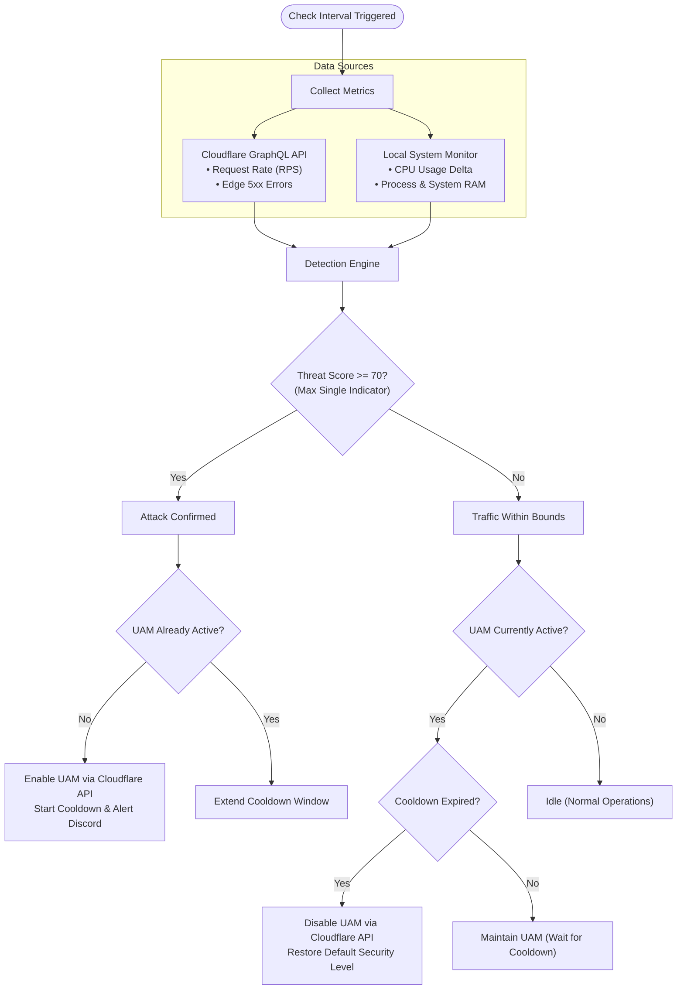

# Cloudflare UAM Guardian Daemon

[](LICENSE)
[](https://nodejs.org)
[](https://www.typescriptlang.org/)
[](https://makeapullrequest.com)

A background daemon that automates Cloudflare's **Under Attack Mode (UAM)** toggle based on real-time edge traffic metrics, origin HTTP error rates, and local server hardware load.

Cloudflare Under Attack Mode enforces a JavaScript/CAPTCHA challenge to incoming visitors. Enabling and disabling it manually through the Cloudflare dashboard creates operational delay during sudden Layer 7 DDoS attacks and often leaves the challenge active longer than necessary after traffic normalizes. This daemon automates the entire lifecycle: detecting incoming volumetric or origin-exhaustion attacks, enabling UAM via Cloudflare API v4, holding a configurable cooldown period to prevent flapping, and safely reverting to your baseline security level once traffic returns to normal.

---

## How It Works



### 1. What Triggers Under Attack Mode
The daemon evaluates traffic across three separate vectors:
- **Volumetric HTTP Floods (RPS):** Queries Cloudflare's GraphQL Analytics API (`httpRequestsAdaptiveGroups`) over a rolling 3-minute window. Triggers when requests per second exceed `ENABLE_THRESHOLD`.
- **Origin Saturation / Low-and-Slow (HTTP 5xx):** Attacks targeting expensive endpoints (such as heavy database queries or un-cached search routes) can exhaust origin capacity at modest request rates. If edge responses in the 500–599 range exceed `ERROR_RATE_THRESHOLD`, the daemon triggers UAM even if total RPS remains low.
- **Direct-to-Origin Bypass (CPU Load):** Edge analytics typically report with a 1–2 minute delay. The local monitor samples CPU time deltas (`os.cpus()`) every 2 seconds. If origin CPU load crosses `CPU_THRESHOLD`, UAM is activated immediately to mitigate attacks that bypass CDN caching.

### 2. Threat Scoring Without Dilution
Multi-rule detection engines often average their scores, which can be dangerous: a 99% CPU spike averaged with a 0% error rate would result in a diluted score (~33%), ignoring an active attack. This daemon ensures that the overall score is at least equal to the highest individual rule score. A critical breach on any single vector will trigger defensive action right away.

### 3. Failsafe on API Outages
If network disruption or upstream Cloudflare issues prevent metric collection, `getTrafficMetrics()` returns `null` rather than zeros. The daemon treats `null` as "data unavailable" and **preserves the existing state**. It will never assume an API failure means "traffic has stopped" and turn off UAM during an active incident. If failures persist beyond `MAX_CONSECUTIVE_API_FAILURES`, an alert is dispatched.

### 4. Cooldown Period & External Sync
- **Cooldown (Anti-Flapping):** UAM uses separate activation (`ENABLE_THRESHOLD`) and deactivation (`DISABLE_THRESHOLD`) boundaries, followed by a mandatory `COOLDOWN_MINUTES` waiting period of quiet traffic before deactivation occurs.
- **Dashboard Reconciliation:** If an operator toggles UAM directly via the Cloudflare dashboard, the daemon detects the change during its periodic sync, updates its local state file, and logs an audit record without overwriting the administrator's manual action.

### 5. Security & Credential Protection
- **Log Sanitization:** Sensitive values (`CF_API_TOKEN`, webhook tokens, authorization headers) are masked at startup and scrubbed from all structured logs via recursive redaction with depth limits and circular-reference protection.
- **State File Permissions:** Local state files (`uam-state.json`) are written atomically with POSIX `0600` permissions (owner read/write only).
- **Webhook Restrictions:** Outbound alert destinations are strictly validated to prevent redirection to private IP ranges or unauthorized endpoints.

---

## Prerequisites

- **Node.js:** v20.x LTS or higher
- **Process Manager:** PM2 (recommended for production)
- **Cloudflare API Token:** Configured with the following permissions:
  - `Zone` > `Zone Settings` > `Edit`
  - `Zone` > `Analytics` > `Read`
- **Zone ID:** Found on your domain's **Overview** page in the Cloudflare dashboard.

---

## Installation & Production Deployment

### 1. Clone & Install Dependencies
```bash
git clone https://github.com/shditz/cloudflare-uam-guardian.git /opt/uam-automation
cd /opt/uam-automation

# Install production dependencies
npm install --production=false
```

### 2. Configure Environment
Copy the sample environment file:
```bash
cp .env.example .env
chmod 600 .env
nano .env
```

Here is a minimal `.env` template to get started:
```env
# Required Cloudflare Credentials
CF_API_TOKEN=your_cloudflare_api_token_here
CF_ZONE_ID=your_32_character_zone_id_here

# Core Detection Thresholds
CHECK_INTERVAL=10
ENABLE_THRESHOLD=1200
DISABLE_THRESHOLD=350
ERROR_RATE_THRESHOLD=5
COOLDOWN_MINUTES=5
DEFAULT_SECURITY_LEVEL=medium

# Optional Local Hardware Monitoring
LOCAL_MONITORING_ENABLED=true
CPU_THRESHOLD=90

# Optional Discord Alerts
DISCORD_WEBHOOK_URL=https://discord.com/api/webhooks/your_id/your_token
```

> [!NOTE]
> **Running inside Docker / LXC Containers:**  
> The local CPU monitor relies on Node's `os.cpus()` to measure system load. Inside containers, `os.cpus()` typically reports total CPU usage of the host machine rather than container-specific limits. If this daemon runs inside a shared container or alongside resource-intensive neighbors, consider setting `LOCAL_MONITORING_ENABLED=false` to rely strictly on Cloudflare edge traffic and error metrics.

### 3. Build & Verify
Compile TypeScript source to JavaScript and run the test suite:
```bash
# Compile TypeScript to dist/
npm run build

# Run unit tests
npm test
```

### 4. Start via PM2
The repository includes an `ecosystem.config.js` with memory boundaries (150MB restart ceiling), log timestamps, and single-instance constraints:
```bash
# Start daemon with PM2
pm2 start ecosystem.config.js

# Verify daemon status
pm2 status uam-automation

# Persist across system reboots
pm2 save
pm2 startup
```

---

## Configuration Reference

All settings are configured via environment variables in `.env`:

| Variable | Type | Default | Description |
| :--- | :--- | :--- | :--- |
| `CF_API_TOKEN` | String | *Required* | Cloudflare API Token with `Zone Settings: Edit` and `Analytics: Read`. |
| `CF_ZONE_ID` | String | *Required* | 32-character hexadecimal Zone ID for your target domain. |
| `CHECK_INTERVAL` | Integer | `10` | Frequency (in seconds) between traffic checks. Recommended: `5`–`15`. |
| `ENABLE_THRESHOLD` | Integer | `1200` | Requests Per Second (RPS) required to trigger Under Attack Mode. |
| `DISABLE_THRESHOLD` | Integer | `350` | Maximum RPS permitted before the system will consider deactivating UAM. Must be lower than `ENABLE_THRESHOLD`. |
| `ERROR_RATE_THRESHOLD` | Number (1–100) | `5` | HTTP 5xx error percentage at the edge required to trigger attack state. |
| `COOLDOWN_MINUTES` | Integer | `5` | Duration (in minutes) traffic must remain below `DISABLE_THRESHOLD` before reverting security level. |
| `DEFAULT_SECURITY_LEVEL` | String | `medium` | Security level restored when UAM is disabled: `off`, `essentially_off`, `low`, `medium`, `high`. |
| `LOCAL_MONITORING_ENABLED` | Boolean | `true` | Enables local multi-core CPU monitoring (`true`/`false`). |
| `CPU_THRESHOLD` | Number (1–100) | `90` | Origin average CPU utilization percentage that immediately triggers UAM. |
| `DISCORD_WEBHOOK_URL` | String | *Optional* | Discord webhook URL for notifications. Must point to a valid `discord.com` domain. |
| `LOG_LEVEL` | String | `info` | Logging verbosity: `trace`, `debug`, `info`, `warn`, `error`, `fatal`. |
| `STATE_FILE_PATH` | String | `./uam-state.json` | Path to persistent state file tracking attack status and timestamps. |
| `HEARTBEAT_INTERVAL_MINUTES`| Integer | `360` | Interval (in minutes) for periodic status notifications to Discord. |
| `MAX_CONSECUTIVE_API_FAILURES` | Integer | `5` | Cloudflare API failure count before a `CRITICAL` Discord alert is sent. |

### Selecting Thresholds
- **Baseline RPS:** Review your Cloudflare Analytics dashboard during peak business hours. Set `ENABLE_THRESHOLD` at approximately 2.5x to 3x your normal peak RPS.
- **Disable Threshold:** Set `DISABLE_THRESHOLD` at 1.2x to 1.5x your baseline peak. Keeping a substantial gap between enable and disable thresholds prevents rapid cycling.
- **Cooldown Window:** Keep `COOLDOWN_MINUTES` at 5 minutes or higher. Many distributed attack scripts pause briefly before resuming with higher volume.

---

## Operations & Monitoring

### Process Management
```bash
# Check process health and uptime
pm2 show uam-automation

# Tail live application logs
pm2 logs uam-automation --lines 50

# Restart daemon after updating .env
pm2 restart uam-automation --update-env

# Stop daemon
pm2 stop uam-automation
```

### Log Structure & Audit Trail
Logs are structured as JSON via Pino with standard ISO timestamps and contextual metadata:
```json
{
  "level": 30,
  "time": "YYYY-MM-DDTHH:mm:ss.sssZ",
  "name": "uam-guardian",
  "tickId": "tick-142",
  "rps": 1450,
  "errorRate": "0.12%",
  "cpuUsage": "34.2%",
  "status": "ATTACK",
  "score": 100,
  "isUnderAttack": false,
  "msg": "Evaluated traffic state"
}
```

State transitions produce an audit log detailing the previous and updated state:
```json
{
  "level": 30,
  "time": "YYYY-MM-DDTHH:mm:ss.sssZ",
  "name": "uam-guardian",
  "transition": "ENABLED_UAM",
  "before": { "isUnderAttack": false, "enabledAt": null },
  "after": { "isUnderAttack": true, "enabledAt": 1700000000000, "lastDecision": "ENABLED_UAM" },
  "msg": "State transition recorded"
}
```

### Recommended: Log Rotation Setup
To prevent unmanaged log growth on production servers, configure PM2 log rotation:
```bash
pm2 install pm2-logrotate
pm2 set pm2-logrotate:max_size 50M
pm2 set pm2-logrotate:retain 14
pm2 set pm2-logrotate:compress true
```

---

## Troubleshooting

### 1. `Cloudflare API authentication failed (401/403)`
- **Cause:** Invalid API token or insufficient permissions.
- **Resolution:** Verify that the API token was created under the correct Cloudflare account and that permissions include `Zone Settings: Edit` and `Analytics: Read` scoped to the relevant Zone ID. Run `curl -X GET "https://api.cloudflare.com/client/v4/zones/$CF_ZONE_ID" -H "Authorization: Bearer $CF_API_TOKEN"` to test manually.

### 2. `Cloudflare GraphQL response contained no zone data`
- **Cause:** `CF_ZONE_ID` does not match the zone associated with the token, or the domain has not had HTTP proxying (orange cloud) enabled long enough to register analytics data.
- **Resolution:** Double check the 32-character Zone ID on the domain overview page.

### 3. `Rate limited by Cloudflare API (429)`
- **Cause:** Too many API requests per minute.
- **Resolution:** The daemon implements automatic exponential backoff compliant with RFC-7231 (`Retry-After` header parsing). If you encounter frequent 429s, increase `CHECK_INTERVAL` in `.env` (e.g., from `5` to `15` seconds).

### 4. `DISCORD_WEBHOOK_URL must point to discord.com webhook endpoint`
- **Cause:** Invalid webhook URL supplied.
- **Resolution:** Ensure the URL begins with `https://discord.com/api/webhooks/` or `https://ptb.discord.com/api/webhooks/`. Arbitrary domains are blocked for SSRF defense.

### 5. `Cloudflare is in Under Attack Mode, but local state was false`
- **Behavior:** This is expected recovery behavior. On startup or during checks, the daemon queries Cloudflare directly. If UAM is already active (e.g., toggled manually or by a previous process), the daemon aligns its local state without disabling protection.

---

## Testing

A dedicated test suite validates the detection logic:
```bash
npm test
```
The test suite covers:
1. Normal baseline traffic validation.
2. Warning-level RPS evaluation.
3. Volumetric attack threshold breach.
4. Origin 5xx error rate escalation.
5. Hardware CPU saturation detection.
6. Multi-factor non-diluted score verification.

---

## License

This project is licensed under the [MIT License](LICENSE).

